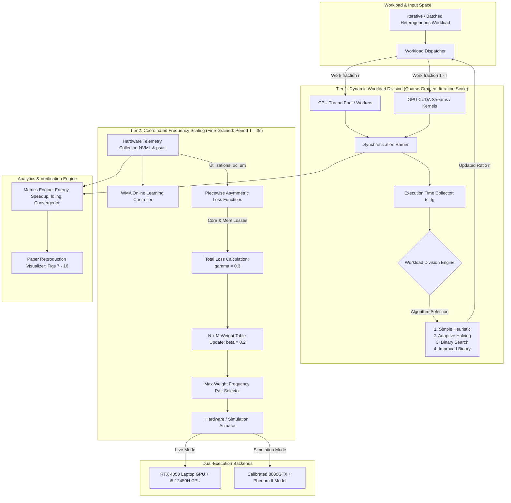
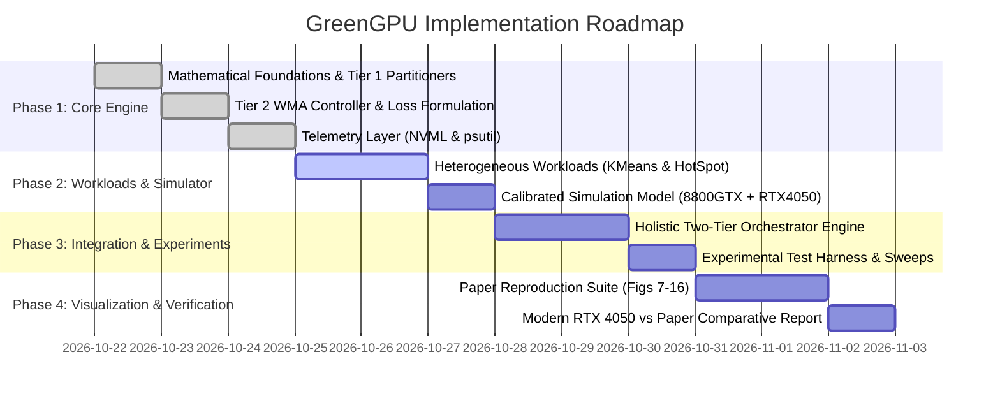

# ATLAS GreenGPU: System Architecture & Implementation Roadmap

> **Reference Research Paper:**  
> *Energy conservation for GPU–CPU architectures with dynamic workload division and frequency scaling*  
> Kai Ma, Yunhao Bai, Xiaorui Wang, Wei Chen, Xue Li (The Ohio State University & University of Tennessee)  
> *Sustainable Computing: Informatics and Systems* (SUSCOM), Vol. 12, 2016, pp. 21–33.

---

## 1. System Mission & Architectural Vision

The **ATLAS GreenGPU** project implements, extends, and modernizes the holistic two-tier runtime energy management architecture proposed in the GreenGPU research paper. 

### Core Scientific Thesis
In heterogeneous CPU–GPU computing systems, naive execution models either:
1. Offload **100% of parallel workloads to the GPU** while the host CPU idles at non-zero baseline power, extending wall-clock execution time and wasting total system energy.
2. Throttling hardware resources (GPU cores, GPU memory, or CPU) in isolation without accounting for memory vs. compute bottlenecks and cross-device synchronization barriers.

By introducing a **decoupled, two-tier hierarchical controller**, GreenGPU simultaneously:
- **Tier 1 (Workload Division)**: Dynamically partitions workloads between CPU and GPU such that both finish concurrently ($t_c \approx t_g$), eradicating idle barrier waiting.
- **Tier 2 (Coordinated DVFS)**: Dynamically scales GPU core and memory frequencies using an online **Weighted Majority Algorithm (WMA)** with asymmetric loss functions, throttling under-utilized components without degrading performance.

---

## 2. High-Level System Architecture

The following diagram illustrates the complete ATLAS GreenGPU runtime architecture, highlighting the flow of telemetry, workload partitioning, actuation, and dual execution backends:



---

## 3. Mathematical Foundations & Control Algorithms

### 3.1 Tier 1: Dynamic Workload Partitioning Algorithms

Let $r \in [0, 1]$ denote the fraction of total workload assigned to the CPU, while $1 - r$ is assigned to the GPU.  
Let $t_c$ and $t_g$ be the execution time measured on the CPU and GPU in the current iteration (including PCIe memory transfer overheads).

#### Algorithm 1: Simple Heuristic (Fixed Step Size with Lookahead Safeguard)
* **Adjustment Rule:**
  $$\Delta r = 
  \begin{cases} 
  -\Delta, & \text{if } t_c > t_g \\ 
  +\Delta, & \text{if } t_c < t_g 
  \end{cases} \quad (\text{default } \Delta = 0.03 \text{ or } 0.05)$$
* **Linear Lookahead Safeguard:** Prevents limit-cycle oscillation between discrete buckets.  
  Before applying $r \to r'$, compute predicted times:
  $$t_c' = \frac{r'}{r} t_c, \quad t_g' = \frac{1 - r'}{1 - r} t_g$$
  If applying $\Delta$ flips the sign of $(t_c' - t_g')$ relative to $(t_c - t_g)$, retain the current $r$ to avoid oscillation thrashing.

#### Algorithm 2: Improved Heuristic (Adaptive Step-Size Halving)
* Starts with a coarse step size (e.g., $\Delta_0 = 0.15$ or $0.20$).
* Operates as Simple Heuristic until a sign flip in direction occurs (oscillation detected).
* Halves the step size: $\Delta \leftarrow \Delta / 2$.
* Terminates step updates when $\Delta < P_t$ (e.g., $P_t = 0.01$).

#### Algorithm 3: Binary Search
* Slices the remaining search bracket in half:
  $$r' = 
  \begin{cases}
  \frac{1 + r}{2}, & \text{if } t_c < t_g \text{ (shift work to CPU)} \\
  \frac{r}{2}, & \text{if } t_c > t_g \text{ (shift work to GPU)}
  \end{cases}$$
* **Theoretical Guarantee:** Converges in at most $\lceil \log_2(100 / P_t) \rceil \le 7$ iterations for $P_t = 1\%$.
* *Limitation:* May overshoot when initial $r$ is already near optimal.

#### Algorithm 4: Improved Binary Search (Proportional Time Matching)
* Incorporates the **quantitative magnitude** of the execution time discrepancy:
  $$\frac{t_c}{t_g} = \frac{r / (1 - r)}{r' / (1 - r')}$$
* Solving explicitly for the target ratio $r'$:
  $$\frac{r'}{1 - r'} = \left(\frac{t_g}{t_c}\right) \left(\frac{r}{1 - r}\right) \implies r' = \frac{k}{1 + k}, \quad \text{where } k = \left(\frac{t_g}{t_c}\right) \left(\frac{r}{1 - r}\right)$$
* **Advantage:** Eliminates hunting/oscillation and reaches equilibrium within **4 to 5 iterations**.

---

### 3.2 Tier 2: Coordinated GPU Core & Memory DVFS

Let $N$ be the number of available GPU core clock levels and $M$ be the number of memory clock levels. The system maintains an $N \times M$ weight table $\mathbf{W} \in \mathbb{R}^{N \times M}$, initialized to uniform weights ($W_{ij} = 0$).

#### Piecewise Asymmetric Loss Functions
For each discrete clock level $i \in \{1, \dots, N\}$, let $u_{\text{mean}}[i]$ be the target utilization linearly mapped between $0\%$ (lowest clock) and $100\%$ (peak clock). Let $u$ be the sampled runtime utilization:

$$\text{Energy Loss } l_e = \max(0, \, u_{\text{mean}}[i] - u)$$
$$\text{Performance Loss } l_p = \max(0, \, u - u_{\text{mean}}[i])$$

1. **Core Loss:**
   $$l_{c,i}^{(t)} = \alpha_c \cdot l_{ce,i}^{(t)} + (1 - \alpha_c) \cdot l_{cp,i}^{(t)}, \quad \alpha_c = 0.15$$
2. **Memory Loss:**
   $$l_{m,j}^{(t)} = \alpha_m \cdot l_{me,j}^{(t)} + (1 - \alpha_m) \cdot l_{mp,j}^{(t)}, \quad \alpha_m = 0.02$$
3. **Total Joint Loss:**
   $$\text{TotalLoss}_{ij}^{(t)} = \gamma \cdot l_{c,i}^{(t)} + (1 - \gamma) \cdot l_{m,j}^{(t)}, \quad \gamma = 0.3$$
4. **WMA Weight Update Rule:**
   $$W_{ij}^{(t+1)} = W_{ij}^{(t)} + \left[1 - (1 - \beta) \cdot \text{TotalLoss}_{ij}^{(t)}\right], \quad \beta = 0.2$$
5. **Actuation Selection:**
   $$(i^*, j^*) = \arg\max_{i, j} W_{ij}^{(t+1)}$$
   Enforce core frequency $f_{c, i^*}$ and memory frequency $f_{m, j^*}$.

---

### 3.3 Decoupling Condition (Stability Criterion)

To prevent destructive control feedback between Tier 1 workload redistribution and Tier 2 DVFS adaptation:
$$T_{\text{Tier 1}} \ge 40 \times T_{\text{Tier 2}}$$
With $T_{\text{Tier 2}} = 3\text{ seconds}$, a Tier 1 workload iteration interval of $\ge 120\text{ seconds}$ (or batched multi-iteration phases) guarantees the WMA weight table converges to the optimal $(f_c^*, f_m^*)$ before the next workload rebalancing occurs.

---

## 4. Software Modular Architecture

```
ATLAS/
├── greengpu/
│   ├── __init__.py
│   ├── config.py                 # Hyperparameters (alpha, beta, gamma, Pt, thresholds)
│   ├── telemetry/
│   │   ├── __init__.py
│   │   ├── base.py               # Abstract telemetry monitor interface
│   │   ├── nvml_monitor.py       # Ctypes/native NVML reader (GPU power, util, clocks)
│   │   ├── cpu_monitor.py        # psutil / Windows counter monitor (CPU util, freq)
│   │   └── mock_monitor.py       # Synthetic monitor for deterministic CI/simulation
│   ├── tier1/
│   │   ├── __init__.py
│   │   ├── base.py               # Partitioner abstract base class
│   │   ├── simple_heuristic.py   # Fixed step with lookahead safeguard
│   │   ├── adaptive_heuristic.py # Step-halving adaptive partitioner
│   │   ├── binary_search.py      # Standard binary search partitioner
│   │   └── improved_binary.py    # Proportional time matching partitioner
│   ├── tier2/
│   │   ├── __init__.py
│   │   ├── loss_functions.py     # Asymmetric energy & performance loss formulas
│   │   ├── wma_controller.py     # Online Weighted Majority Algorithm engine
│   │   └── actuator.py           # Clock & power actuation (Live NVML vs Simulation)
│   ├── workloads/
│   │   ├── __init__.py
│   │   ├── base.py               # Abstract heterogeneous workload interface
│   │   ├── kmeans.py             # Heterogeneous K-Means Clustering (reduction benchmark)
│   │   ├── hotspot.py            # Heterogeneous 2D HotSpot Grid (stencil benchmark)
│   │   └── synthetic_bench.py    # Tunable compute-bound and memory-bound kernels
│   ├── engine.py                 # Top-level GreenGPU 2-tier orchestrator
│   └── simulator.py              # Calibrated performance/energy simulation model
├── experiments/
│   ├── run_partitioner_study.py  # Convergence comparison across all 4 partitioners
│   ├── run_dvfs_study.py         # WMA loss & weight convergence evaluation
│   ├── run_holistic_benchmark.py # Full system comparison (Baseline vs Div vs DVFS vs GreenGPU)
│   └── run_hardware_profiler.py  # Live profiling on RTX 4050 + Intel i5-12450H
├── visualizer/
│   ├── __init__.py
│   ├── plot_paper_figures.py     # Reproduces Figures 7, 8, 9, 10, 11, 12, 14, 15, 16
│   └── dashboard.py              # Interactive terminal / web analytics summary
├── tests/
│   ├── test_tier1.py             # Unit tests for all 4 partitioners
│   ├── test_tier2.py             # Unit tests for loss functions & WMA updates
│   ├── test_telemetry.py         # Unit tests for NVML & CPU monitors
│   └── test_workloads.py         # End-to-end workload execution verification
├── ARCHITECTURE.md               # This architectural specification
└── .gitignore                    # Project gitignore
```

---

## 5. Detailed Project Implementation Phases



### Phase 1: Core Algorithmic & Telemetry Layer
* **Objective:** Build mathematically rigorous, fully unit-tested implementations of Tier 1 partitioners, Tier 2 WMA controller, and real-time hardware telemetry.
* **Deliverables:**
  1. `greengpu/config.py`: Full hyperparameter configuration object.
  2. `greengpu/telemetry/nvml_monitor.py`: Zero-overhead ctypes interface to `nvml.dll` reading GPU power (mW), core utilization ($u_c$), memory utilization ($u_m$), and clocks.
  3. `greengpu/telemetry/cpu_monitor.py`: CPU frequency and utilization reader via `psutil`.
  4. `greengpu/tier1/`: Implementations of Simple Heuristic, Adaptive Heuristic, Binary Search, and Improved Binary Search.
  5. `greengpu/tier2/`: Asymmetric loss calculator and WMA weight table state machine.
  6. `tests/`: Complete unit test coverage for mathematical correctness.

### Phase 2: Heterogeneous Workloads & Calibrated Simulator
* **Objective:** Implement real cooperatively executed workloads and a dual-target hardware simulator.
* **Deliverables:**
  1. `greengpu/workloads/kmeans.py`: PyTorch-accelerated parallel K-Means clustering kernel that splits data points between CPU (OpenMP / PyTorch CPU) and GPU (CUDA stream).
  2. `greengpu/workloads/hotspot.py`: 2D iterative thermal diffusion grid with barrier synchronization.
  3. `greengpu/simulator.py`: High-fidelity hardware model reproducing the published specs of Testbed A (GeForce 8800 GTX + AMD Phenom II) and Testbed B (Tesla 2070 + Xeon), plus the local modern hardware profile (RTX 4050 + i5-12450H).

### Phase 3: Holistic Two-Tier Engine & Experimental Sweeps
* **Objective:** Integrate Tier 1 and Tier 2 into the master decoupled controller and execute structured experimental sweeps.
* **Deliverables:**
  1. `greengpu/engine.py`: Dynamic runtime orchestrating periodic Tier 1 reallocation and high-frequency Tier 2 DVFS updates.
  2. `experiments/run_partitioner_study.py`: Runs all 4 partitioners across initial conditions ($r \in \{15\%, 50\%, 90\%\}$) and records iteration-by-iteration traces.
  3. `experiments/run_holistic_benchmark.py`: Evaluates the 4 core configurations:
     - **Baseline:** Best-Performance (100% on GPU, peak clocks).
     - **Division Only:** Optimal / dynamic workload division with static peak clocks.
     - **DVFS Only:** 100% on GPU with Tier 2 WMA frequency scaling.
     - **GreenGPU Holistic:** Tier 1 + Tier 2 concurrent optimization.

### Phase 4: Publication Visualization & Comparative Analysis
* **Objective:** Generate exact 1-to-1 visual reproductions of the research paper's figures and document modern architectural observations.
* **Deliverables:**
  1. `visualizer/plot_paper_figures.py`: Matplotlib/Seaborn reproduction pipeline generating:
     - **Figure 7 & 8:** Workload division and energy per iteration traces for `hotspot` and `kmeans`.
     - **Figures 9–13:** Convergence trajectories of the 4 algorithms across initial ratios.
     - **Figure 14 & 15:** Bar charts comparing convergence iteration counts.
     - **Figure 16:** Total energy consumption bar charts proving Improved Binary superiority.
  2. Final verification report comparing the historical 2016 testbed results with modern Ada Lovelace / Intel 12th Gen characteristics.

---

## 6. Target Metrics & Verification Protocol

| Metric | Target / Benchmark Expectation | Verification Source |
| :--- | :--- | :--- |
| **Convergence Speed (Iter)** | Improved Binary Search converges in $\le 5$ iterations; Binary in $\le 7$; Heuristic in $15\text{--}25$. | Paper Figs 11, 12, 14 |
| **Idling Time Reduction** | Minimize $|t_c - t_g| \to 0$ within tolerance $\epsilon = 5\%$. | Paper Section 5.2 |
| **Holistic Energy Savings** | Average **$\approx 21.04\%$** total energy savings over Best-Performance baseline. | Paper Section 7.3 |
| **Dynamic Energy Savings** | Up to **$29.2\%$** dynamic GPU energy reduction. | Paper Section 7.1 |
| **Execution Time Overhead** | System execution time within **$< 3.0\%$** of optimal fastest configuration. | Paper Section 7.1 |
| **DVFS Memory Scaling** | Core-bounded kernels (`nbody`) throttle memory frequency without loss; memory-bounded (`streamcluster`) preserve memory frequency. | Paper Fig 1 & Fig 5 |

---

## 7. Operational Guidelines & Safety Constraints

1. **Git Policy:** Strict compliance with repository directives: **No remote pushes (`git push`) under any circumstances** without explicit instruction.
2. **Hardware Protection:** All live frequency and power limit calls through NVML are bounded within certified manufacturer ranges ($P_{\text{min}} = 5\text{ W}, P_{\text{max}} = 55\text{ W}$ for the RTX 4050).
3. **Reproducibility:** All synthetic and simulated runs are seeded for deterministic regression testing.
