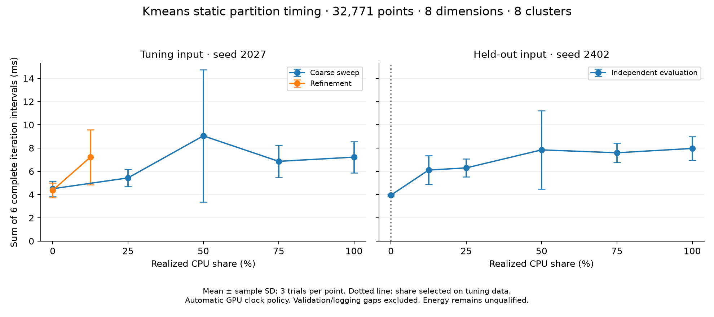

# Phase 4 review: heterogeneous kmeans

2026-10-31. **Implementation, correctness, migration, concurrency, and exploratory
static timing validation pass.** The full Phase 4 research exit gate remains
blocked because Phase 2 has not qualified physical energy measurement. No energy
minimum, GreenGPU saving percentage, or fixed-frequency result is claimed.

## Implemented workload

The native `atlas_kmeans` executable performs Lloyd kmeans with FP64 arithmetic,
squared Euclidean distance, lowest-index exact ties, and retained empty centroids.
A persistent CPU dispatcher uses bounded OpenMP workers for a prefix of points;
CUDA assigns the remaining suffix. Both use the same centroids and produce local
coordinate sums, counts, and assignment objective. The host merges once after
both branches complete and publishes the next centroids.

Point storage, device allocations, the stream, and CPU reduction scratch persist.
GPU expansion uploads only points missing from its residency cache. Shrinking
ownership preserves cached immutable points; the host master copy stays valid.
All GPU memberships return each iteration, keeping the host state current when
ownership changes. Records distinguish logical migration from actual transfer
bytes. Full final labels and centroids are exported.

Fixed-budget runs always perform all requested iterations. Separate convergence
runs stop on unchanged labels or maximum centroid displacement at most 1e-6,
subject to an iteration cap. An independent native scalar reference advances its
own trajectory; a Python oracle additionally checks every small-fixture iteration.
Labels/counts must match exactly. Sums, centroids, and objectives use the frozen
tolerance `1e-8 + 1e-10 * abs(reference)`.

See the [complete algorithm, input, ownership, and timing contract](kmeans_spec.md).
The implementation is in [native/kmeans](../native/kmeans/main.cu), with
[experiment orchestration](../src/greengpu/kmeans.py) and an
[independent Python reference](../src/greengpu/kmeans_reference.py).

## Validation evidence

The authoritative archive is
[2026-10-31-final-v2](../results/phase4/2026-10-31-final-v2/manifest.json).
Its [summary](../results/phase4/2026-10-31-final-v2/summary.json) contains:

- 102 successful trials: 55 correctness, seven changing-boundary, 15 coarse tuning,
  six refinement, 18 held-out evaluation, and one separate profile trial.
- 491 measured iterations and 102 warm-up iterations. Twenty trials use convergence
  mode; fixed and convergence results are never mixed into timing curves.
- Sixteen passing same-input equivalence groups across splits and schedules.
- Endpoint and interior splits, one-item branches, exact ties, empty clusters,
  duplicate points/centroids, K=N, K=1, signed fractional values, and partial blocks.
- CPU/GPU kernel overlap in all three measured profiling iterations.

[All 51 Python tests pass](../results/phase4/verification/unit-tests.txt), as do
[all four native CTests](../results/phase4/verification/ctest.txt).
[CUDA memcheck](../results/phase4/verification/memcheck.json) reports zero errors;
[racecheck](../results/phase4/verification/racecheck.json) reports zero errors or
warnings. These checks use N=257, D=3, K=4 and CPU counts
`257,128,0,257,0`, exercising partial CUDA blocks and residency reuse in both
migration directions. Sanitizers and final experiments use the same binary hash.

The [integrity audit](../results/phase4/verification/audit.json) verifies the archive
inventory/checksums, identical summary replay, current source/header hashes,
executable identity, all dataset hashes, and CTest fixture identity. Phase 2 and
Phase 3 summaries replay unchanged. The original research paper hash is unchanged.

## Static timing result

The benchmark uses generated N=32,771, D=8, K=8 inputs, fixed six-iteration trials,
and four CPU workers. Tuning seed 2027 and held-out seed 2402 use their own recorded
Forgy initialization. The coarse sweep covers approximately 0%, 25%, 50%, 75%, and
100% CPU ownership; fresh trials refine near the candidate minimum. Each point
has three trials in seeded randomized block order. The selected share is frozen
before held-out evaluation.

The selected CPU count is **zero**, and GPU-only also has the lowest observed
held-out mean among sampled candidates: **3.955 ms, sample SD 0.077 ms**, summed
across six complete iteration intervals. The approximately 50/50 split measures
7.847 ms (SD 3.380 ms); CPU-only measures 7.971 ms (SD 1.021 ms). These are small,
instrumented exploratory trials, not a global or statistically established
optimum. Timing variability and slower cases remain in the evidence.

The standalone [SVG](../results/phase4/figures-final/kmeans-runtime.svg),
[figure provenance](../results/phase4/figures-final/provenance.json), and
[numeric curves](../results/phase4/2026-10-31-final-v2/timing-curves.json) are retained.
Error bars are sample standard deviations across trials, not confidence intervals.

Each measured interval includes branch dispatch, initial or migration uploads,
centroid transfers, aggregate resets, computation, membership/aggregate downloads,
synchronization, merging, and state handoff. Validation and JSON logging between
iterations are excluded from the plotted sum and included in the separately
reported loop elapsed time. Startup/allocation and one discarded warm-up are
outside iteration timing. Warm-up residency is reset, so the first measured
iteration pays for its initial point upload.

The FP64 GPU kernel uses atomic reductions and returns full memberships each
iteration. It is a correctness-first baseline with potential reduction contention,
not a tuned library implementation. The generated data is not the paper's original
dataset. Automatic GPU clock policy is unchanged; clocks are not locked or
verified constant. Thermal equilibrium, exclusive system use, and CPU affinity
are not claimed. Those limits prevent treating these numbers as a reproduction
of the historical paper's performance.

## Concurrency and retained development evidence

The separate profile uses N=65,539, D=32, K=32 and 49,154 CPU points. Actual CUDA
kernel activity overlaps annotated CPU compute regions in all three measured
iterations, with overlap unions approximately 1.214, 1.216, and 1.210 ms on Nsight's
correlated timeline. The [capture](../results/phase4/2026-10-31-final-v2/profile.nsys-rep),
[SQLite export](../results/phase4/2026-10-31-final-v2/profile.sqlite), and
[trace JSON](../results/phase4/2026-10-31-final-v2/timeline.json) retain this evidence.
CPU annotations may include scheduling/preemption; the trace is qualitative
concurrency evidence, not an independent calibration of physical elapsed time.

Earlier `probe`, `2026-10-31-validation`, and `2026-10-31-final` directories are
preserved as development evidence. The initial validation predates full final-label
export. The first final run passed all 102 correctness trials but failed the strict
all-iterations overlap gate: the first measured point upload outlasted the CPU
branch in its smaller profile case. The final-v2 run increases only the separate
profile workload to make computation overlap observable; the timing benchmark,
transfer accounting, and acceptance rule remain unchanged. No failed trace was
discarded or reclassified. Smaller or imbalanced tasks need not overlap.

Earlier archives correspond to their recorded source versions. Use final-v2 with
the current replay code; do not combine measurements across archives to select a
faster outcome.

## Handoff

[README commands](../README.md#run-phase-4-kmeans) build, validate, replay, and plot
the workload. Archives are created exclusively and reject overwriting. Checksum
replay rejects added, missing, or altered files; figures live outside the archive.

Phase 5 can implement workload allocation using the common host-clock completion
signals and iteration barrier. Scripted migration is implemented; adaptive
allocation is not. The GPU-only timing minimum is a useful retained baseline that
a later controller must be allowed to lose against.

Energy values remain null. The cumulative GPU counter/power disagreement,
device-event/host timing discrepancy, and absent CPU-package/wall energy described
in the [Phase 2 review](phase2_review.md) still apply. Energy curves, a distinct
energy-optimal split, and energy-saving claims require separate qualification.
The full Phase 4 runtime-and-energy exit gate therefore remains blocked.
