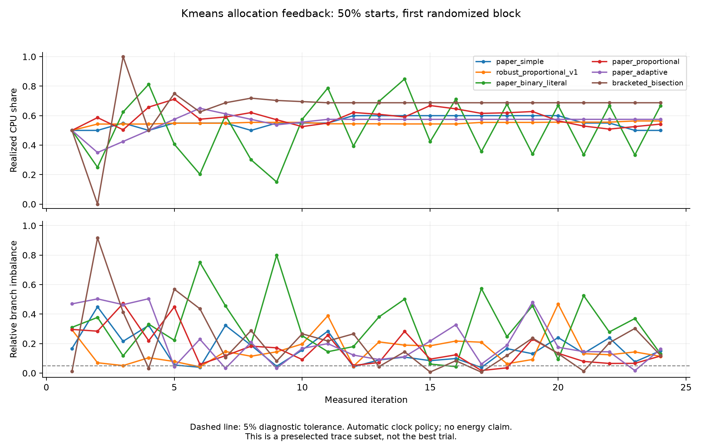
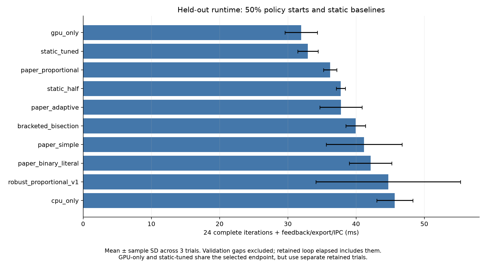

# Phase 5 review: workload allocation

2026-10-31. **Tier 1 implementation, correctness validation, decision replay, and
exploratory timing evaluation pass.** The full research gate remains blocked by
unqualified energy measurement and the absence of verified fixed hardware capacity.
Passing validation does not mean a policy converged or improved runtime.

## Delivered implementation

The [pure policy module](../src/greengpu/allocation.py) implements `paper_simple`,
`paper_adaptive`, `paper_binary_literal`, `bracketed_bisection`,
`paper_proportional`, and the separately specified `robust_proportional_v1`.
Reference-policy behavior is unchanged by the robust extension. Decisions retain
their observations, configuration hash, pre/post state, legal rounded split, and
reason. Invalid or stale observations cannot update policy state.

The [feedback adapter](../src/greengpu/allocation_experiment.py) drives one persistent
native kmeans process per trial. GPU residency, centroids, CPU workers, and previous
memberships survive decisions. Branch completion uses a common release timestamp;
GPU completion includes its transfers. The next split is applied at the iteration
boundary. EOF, illegal counts, and malformed feedback fail safely, and a watchdog
bounds the process lifetime.

Native `control_ns` covers record export, controller/IPC, and receiving the next
partition. The primary comparison sums complete iteration work and those feedback
intervals. Python controller calculation is measured separately but is nested
inside feedback time, so it is not added twice. Full loop elapsed time additionally
includes independent validation gaps. Static baselines use the same instrumentation
and feedback protocol. See the [complete contract](phase5_spec.md).

## Validation and evidence

The authoritative archive is
[2026-10-31-final](../results/phase5/2026-10-31-final/manifest.json), with the full
[summary](../results/phase5/2026-10-31-final/summary.json) and predeclared
[trial plan](../results/phase5/2026-10-31-final/plan.json).

- [69 Python tests pass](../results/phase5/verification/unit-tests.txt), including
  hand calculations, invalid inputs and identity, endpoint probes, sparse-grid
  rounding, overflow protection, precision/stagnation distinctions, phase resets,
  decision corruption, and control-time accounting.
- [Four native CTests pass](../results/phase5/verification/ctest.txt), preserving
  the earlier CPU/CUDA and static kmeans checks.
- 186 hardware trials pass: 84 endpoint/interior correctness trials, 18 separate
  convergence-mode trials, and 84 randomized held-out fixed-work trials.
- All 2,742 measured iterations and 186 warm-ups pass native independent-reference
  checks. Small inputs additionally match the Python oracle. Same-input clustering
  trajectories and final output match across policies and changing partitions.
- All 2,556 live feedback decisions replay from their retained observations and
  reproduce the next realized partition.
- [120 synthetic runs](../results/phase5/2026-10-31-final/synthetic.json) retain
  8,244 observations across stationary, noisy, asymmetric, transfer-dominated, and
  changing-capacity functions. These are analytical assumptions, not hardware data.
- [CUDA memcheck](../results/phase5/verification/memcheck.json) reports zero errors;
  [racecheck](../results/phase5/verification/racecheck.json) reports zero errors or
  warnings on feedback-driven CPU counts `257,128,0,257,0`.
- [Protocol probes](../results/phase5/probe) retain successful feedback plus EOF,
  malformed-input, and illegal-count rejection. The
  [watchdog check](../results/phase5/verification/watchdog.json) confirms an expired
  process is killed and reaped.

The [integrity audit](../results/phase5/verification/audit.json) checks inventory
and hashes, current source/header identity, executable identity, dataset hashes,
sanitizer binary identity, synthetic regeneration, and identical final replay.
Phase 2, 3, and 4 summaries replay unchanged, and the paper is unchanged.

The `probe` and `2026-10-31-validation` directories remain as development evidence.
The latter predates the final overflow guard and static-baseline outcome label.
Use final with the current code; earlier records correspond to their captured
source versions. No slower trials or failed-balance outcomes were discarded.

## Policy findings

The proportional hand calculation returns `3/17`, approximately 0.17647, for
`r=0.3, t_cpu=6, t_gpu=3`. Corrected bisection satisfies the midpoint-width bound
on the stationary monotone fixture, including initial bracket measurements
separately. The literal binary recurrence retains its specified behavior and
reaches the diagnostic budget without sustained balance in its cycle fixture.
The corrected policy does not silently replace that recurrence.

Live outcomes are less favorable than the idealized fixtures. Across the 72
held-out adaptive-policy trials, **one finishes with three consecutive observations
within 5% imbalance**. Ten report an invalid bracket, two report no bracket, eleven
stop adjustment at adaptive precision, and 48 exhaust their iteration budgets
without sustained balance at the end. All still perform the full fixed workload
correctly. Earlier qualifying balance windows, sign reversals, and every hold
reason are retained; a small or zero adjustment is never relabeled as convergence.

The bracket failures are useful evidence that stationary-search assumptions are
not established for these small instrumented live runs under automatic clocks.
They are not correctness failures or proof that no balance point exists under
other conditions. The robust extension also has no guaranteed advantage here.

The trace figure shows every policy from a 50% start in randomized block zero,
chosen by protocol rather than by outcome. Full traces for all starts and blocks
remain in the archive.

## Held-out runtime comparison

All configurations perform 24 iterations on the same newly generated held-out
input: N=32,771, D=8, K=8, seed 6505. Four CPU workers are available. Starts are
15%, approximately 25% (selected from Phase 4 tuning balance observations), 50%,
and 90%. Three randomized blocks include all policy/start combinations and four
static baseline names. The static tuned share was frozen from earlier tuning data.

**GPU-only has the lowest observed mean among the sampled configurations:**
31.959 ms, sample SD 2.386 ms, for iteration work plus feedback/export/IPC. The
separately repeated static-tuned baseline uses the same zero-CPU share and measures
32.939 ms (SD 1.485 ms); these are duplicate configurations with independent trials,
not different algorithms. CPU-only measures 45.668 ms (SD 2.648 ms).

Among the sampled adaptive configurations, proportional allocation from 50% has
the lowest mean: 36.198 ms (SD 0.959 ms). That is approximately 13.3% longer than
the GPU-only mean in this experiment. This post-evaluation descriptive ranking is
not a newly selected policy validated on another held-out set, nor a statistical
significance claim. No dynamic policy is claimed to improve on GPU-only.

Standalone [runtime SVG](../results/phase5/figures-final/allocation-runtime.svg),
[trace SVG](../results/phase5/figures-final/allocation-traces.svg), and
[figure provenance](../results/phase5/figures-final/provenance.json) are retained.
Runtime bars show means and sample SDs, not confidence intervals. The figure uses
50% policy starts plus all static baselines; the summary includes every start.

These short runs include Python/native transport and validation instrumentation.
They are exploratory measurements on synthetic data with automatic platform clock
policy, without verified thermal equilibrium, CPU affinity, or exclusive system
use. They do not reproduce historical GreenGPU numbers or establish a global
runtime optimum. Compare policies within this matched experiment, not directly
against Phase 4's different iteration budget and timing scope.

## Handoff and remaining qualification

[README commands](../README.md#run-phase-5-workload-allocation) build, run, replay,
and plot the evidence. No CPU/GPU clock settings are changed. Archives reject
overwrite, checksum replay rejects changed inventory/content, and figures are
written outside the immutable run directory.

Phase 6 can add HotSpot using these pure policies and iteration-boundary controls.
It must implement and validate actual stencil-state and halo migration; kmeans's
immutable point cache does not solve that problem. Tier 2 frequency control remains
for later phases.

Energy remains null because of the [Phase 2 qualification findings](phase2_review.md).
Adaptation and migration time are included, but their physical energy cannot yet
be reported. Fixed effective capacity is also unverified. The full Phase 5 research
gate remains blocked; no energy-saving percentage or guaranteed controller
convergence is claimed.
