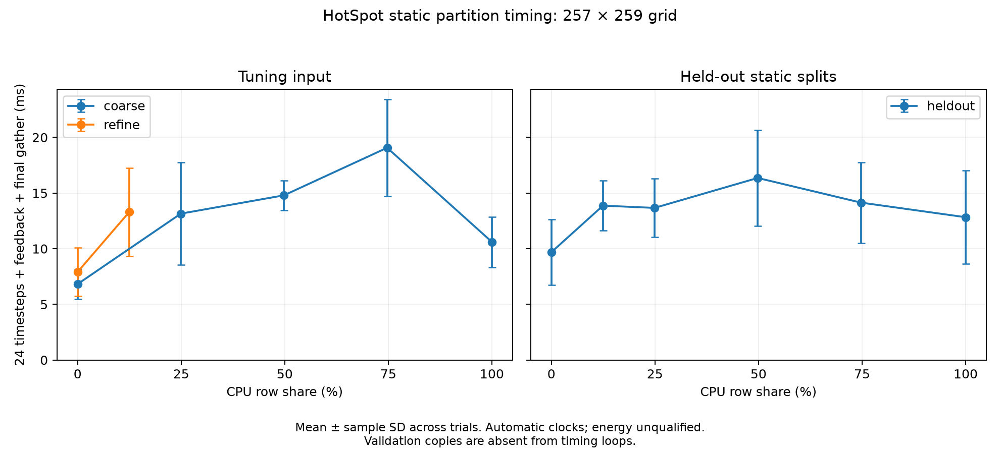
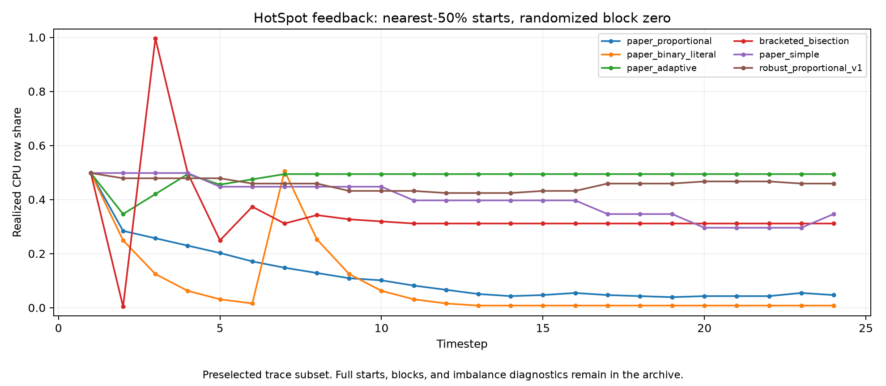
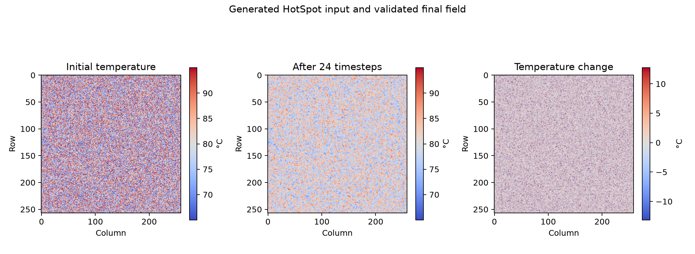

# Phase 6 review: HotSpot state migration

2026-10-31. **The Phase 6 workload/migration exit gate passes:** independent
reference correctness survives changing CPU/GPU ownership, communication costs
are recorded, and all configurations execute the declared grid/timestep budget.
Energy, device-event timing, and fixed-capacity hardware qualification remain
blocked by earlier findings. Those limits are not lifted by this phase.

## Delivered workload

The [native HotSpot backend](../native/hotspot/main.cu) implements the 2D thermal
stencil with OpenMP CPU rows and CUDA GPU rows. Both sides retain previous/next
temperature buffers. Only owned rows are authoritative. Boundary movement copies
the current temperature state before exchanging the new halo rows; immutable
power may stay cached, but evolving temperature cannot.

One persistent native process retains simulation state across decisions. The
[Phase 6 adapter](../src/greengpu/hotspot.py) reuses all six pure Phase 5 policies
with rows as work units. Endpoint-only paths have no halo transfers. CPU/GPU
computation follows a measured shared communication prefix; no communication/
compute overlap optimization is claimed.

The model follows the pinned Rodinia CUDA equations and constants. The corresponding
OpenMP source uses a timestep smaller by 1000. ATLAS selects the CUDA expression,
uses FP64, and applies a documented stability limiter. The source files, exact
revision, original license, and hashes are retained under
[references/rodinia](../references/rodinia/README.md). See the
[full model and measurement contract](hotspot_spec.md) for equations and differences.

Verification and timing are separate modes. Verification gathers each field into
a separate snapshot and checks an independently evolving native long-double
reference. Small fields also match the Python oracle. Timing loops make no full
validation downloads; they gather the final result and verify the complete
trajectory afterward. Validation never refreshes the simulation's host copy.

## Validation evidence

The authoritative archive is
[2026-10-31-final](../results/phase6/2026-10-31-final/manifest.json). Its
[summary](../results/phase6/2026-10-31-final/summary.json) retains **168 successful
trials and 4,299 measured timesteps**, plus one discarded warm-up per trial:

- 24 static correctness trials, six adversarial migration schedules, and 36
  policy-driven correctness trials on six small inputs.
- Six matching migration trials with validation deferred, ensuring that extra
  verification traffic does not hide stale-state errors.
- Two 600-step trajectories, including a 2048×2048 changing-ownership run.
- Fifteen coarse tuning, six fresh refinement, and 72 held-out timing trials.
- One separate three-timestep Nsight concurrency capture.

[All 76 Python tests pass](../results/phase6/verification/unit-tests.txt), including
physical coefficient calculations, stability bounds, degenerate dimensions,
equilibrium, diffusion bounds, lateral-flux cancellation, migration/cache
accounting, and corrupted records. [All six native CTests pass](../results/phase6/verification/ctest.txt).
The two new native checks compare scripted and live-feedback migration with the
Python oracle in both validation modes.

[Memcheck](../results/phase6/verification/memcheck.json) reports zero errors;
[racecheck](../results/phase6/verification/racecheck.json) reports zero errors or
warnings. These checks exercise CPU counts `19,9,0,19,1,18` on an irregular 19×23
grid. The verification driver also retains EOF, malformed-input, illegal-count,
and watchdog cleanup checks. See the [retained driver](../results/phase6/verification/check_native.py).

The [integrity audit](../results/phase6/verification/audit.json) checks source/header,
binary, input, pinned reference, and archive hashes; identical summary/decision
replay; same-input final-field equivalence; and sanitizer binary identity. Phase
2–5 summaries replay unchanged, and the original paper is unchanged.

## Long trajectories and concurrency

The 19×23 trajectory changes its boundary repeatedly over 600 timesteps. Its final
maximum error versus the native long-double reference is approximately
**2.669e-13 °C**, within the frozen `1e-8 + 1e-10*abs(reference)` tolerance.

The large test uses **2048×2048 cells and 600 timesteps**, with CPU rows held for
100-step intervals at `2048,1024,0,1536,1,2047`. Its final maximum error is
approximately **3.932e-14 °C**. The measured work/feedback/final-gather sum is
2.895 seconds; command elapsed is 24.546 seconds, including startup, warm-up,
independent scalar checking, and output. These timings have different scopes.

This matches the paper's grid and iteration counts, but not its original input,
precision, implementation, or necessarily simulated duration. ATLAS's stability
limit selects dt=6.0079648448228514e-8 seconds here, versus the nominal CUDA-model
dt=1.4583333333333335e-7 seconds. The simulated interval is therefore approximately
36.05 microseconds. No exact historical numerical reproduction is claimed.

Actual CUDA kernel activity overlaps annotated CPU computation in all three
measured profile iterations, with overlap unions approximately 0.264, 0.275, and
0.275 ms on Nsight's correlated timeline. The
[capture](../results/phase6/2026-10-31-final/profile.nsys-rep),
[SQLite export](../results/phase6/2026-10-31-final/profile.sqlite), and
[trace JSON](../results/phase6/2026-10-31-final/timeline.json) retain the evidence.
CPU regions may include preemption; this is qualitative overlap evidence, not
independent calibration of physical duration or energy.

## Static timing and allocation findings

Tuning and held-out inputs are distinct generated 257×259 grids. Each timing trial
performs 24 timesteps, with three randomized blocks per configuration. Coarse
endpoint/quarter splits are followed by fresh refinement trials. Tuning selects
zero CPU rows before held-out evaluation. All six policies are evaluated from
15%, nearest 50%, and 90% CPU ownership alongside the static candidates.

**GPU-only has the lowest observed held-out mean:** 9.687 ms, sample SD 2.963 ms.
CPU-only measures 12.828 ms (SD 4.181 ms), and the nearest-50% static split measures
16.355 ms (SD 4.308 ms). Among sampled adaptive configurations, the lowest mean is
13.433 ms (SD 2.394 ms) for `paper_simple` from 39 CPU rows, about 15% ownership.
No adaptive configuration has a lower mean than GPU-only in this experiment.
These are exploratory sample means, not significance or global-optimum claims.

Each timing includes initial uploads, required halo and migration traffic, compute,
barriers, feedback/export/IPC, and the final field gather. Shared communication is
included once in total time and is visible in both branch completion signals. This
fixed prefix can make an apparent timing balance less informative about variable
compute capacity. Small or stopped ratio changes are not convergence evidence.

The static figure uses trial-level sample SDs, not confidence intervals. Allocation
traces show the preselected block-zero/nearest-50% subset; full starts, blocks,
balance diagnostics, and decision states remain in the archive. Standalone SVGs
and [figure provenance](../results/phase6/figures-final/provenance.json) accompany
the PNGs. Automatic clock policy, lack of thermal isolation, and instrumentation
limit interpretation. No settings are changed and no energy saving is claimed.

## Migration compared with kmeans

The [matched ownership-path check](../results/phase6/verification/cache-comparison/comparison.json)
uses rows `19,9,0,19,0` on a 19×23 thermal grid and the corresponding point counts
on 437 kmeans points. Both workloads pass their independent references.

HotSpot transfers **two complete temperature-field equivalents H2D** over that
path and one field equivalent D2H for ownership acquisition, plus one halo row
in each direction. Kmeans uploads its immutable point set **once** and needs no
point-data D2H for CPU acquisition. Kmeans still returns memberships and aggregates;
those are separate traffic. Different datum sizes and computations make raw byte
totals or absolute runtimes across these workloads unsuitable speed comparisons.

This is the concrete difference Phase 6 tests: current thermal state must migrate
again when ownership returns, even when device storage is already allocated and
the power input remains cached. Phase 5's full kmeans allocation results remain
available in its [review](phase5_review.md) and unchanged retained archive.

## Handoff

[README commands](../README.md#run-phase-6-hotspot) build, test, run, replay, and
plot the workload. Inputs and result fields are hashed; evidence directories and
native output files reject overwriting. Probe files remain as development evidence.

Phase 7 can now implement the offline frequency-policy equations and diagnostic
replay. Live clock changes and restoration testing belong to Phase 8. The thermal
model's per-cell power input is simulation data, not GPU power telemetry. Energy,
device-event timing, and fixed-capacity hardware qualification remain unresolved
under the earlier measurement findings.
